<p align="center">
  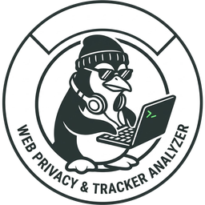
</p>

<h1 align="center">Web Privacy &amp; Tracker Analyzer</h1>

<p align="center">
Analiza <strong>con evidencia</strong> cómo los sitios web recopilan información de sus visitantes,
con qué métodos y hacia quién la envían.
</p>

<p align="center">
  <em>Versión 1.4.8 · beta · herramienta de investigación · se ejecuta solo en <code>127.0.0.1</code></em>
</p>

<p align="center">
  <a href="https://github.com/pulentoski/web-privacy-analyzer-libre-WPAL-/actions/workflows/tests.yml"></a>
</p>

---

## Summary (English)

**Web Privacy & Tracker Analyzer** visits a website with a real, sandboxed Chromium and explains,
**with evidence**, what resources it loads, which third parties it talks to, what data appears to be
sent and how confident each claim is. Every finding carries an evidence level (EVIDENCE, INFERENCE,
POSSIBLE, UNKNOWN) and references to the actual requests; nothing is invented (missing data is
`no_disponible`). It runs as five hardened Docker containers; the capturing worker reaches the
internet **only** through an SSRF-validating Squid proxy. It does **not** inspect servers, perform a
legal audit or guarantee anonymity — a single visit does not represent a site. Self-hosted, offline
data, Spanish UI. Start it with `./scripts/start.sh` and open <http://127.0.0.1:8080>.

> ⚠ **Licencia de datos.** Por defecto (`LICENSE_PROFILE=no_comercial`) se usa el mapa de
> organizaciones de DuckDuckGo Tracker Radar, **CC BY-NC-SA 4.0, no comercial**. Para uso comercial
> existe `LICENSE_PROFILE=comercial`, que lo excluye ([docs/adr/019](docs/adr/019-perfil-de-licencias.md)).
> Estos datos **no** se incluyen en el repositorio: se descargan al ejecutar `./scripts/start.sh`.

Índice: [1. Qué es](#1-qué-es-y-estado) · [2. Qué hace y qué no](#2-qué-hace-y-qué-no-hace) ·
[3. Cómo funciona](#3-cómo-funciona) · [4. Arquitectura](#4-arquitectura) ·
[5. Proxy Squid](#5-el-proxy-squid) · [6. Cómo detecta](#6-cómo-detecta) ·
[7. Cómo clasifica](#7-cómo-clasifica) · [8. Niveles de evidencia](#8-niveles-de-evidencia) ·
[9. Recorrido por la interfaz](#9-recorrido-por-la-interfaz) ·
[10. Ventajas, limitaciones y roadmap](#10-ventajas-limitaciones-y-roadmap) ·
[11. Comparación con otras herramientas](#11-comparación-con-otras-herramientas) ·
[12. Requisitos e instalación](#12-requisitos-descarga-instalación-y-uso) ·
[13. Seguridad y uso responsable](#13-seguridad-y-uso-responsable) ·
[14. Licencia y créditos](#14-licencia-y-créditos) · [15. Desarrollo](#15-desarrollo)

---

## 1. Qué es y estado

Responde, para un sitio cualquiera: *¿con quién habla mi navegador cuando lo visito y qué le
cuenta?* — y lo hace de forma comprobable.

- **Estado:** **beta**, **herramienta de investigación y educativa**. Sirve para auditar un sitio
  propio, enseñar cómo funciona el seguimiento en la web y hacer una demostración en vivo.
- **Principio rector:** *evidencia > suposición*. Todo hallazgo lleva un nivel y referencias a las
  comunicaciones que lo respaldan; sin referencias no hay hallazgo. Lo que falta es `no_disponible`.
- Se ejecuta **solo en `127.0.0.1`**, sin autenticación. No está pensado para exponerse a internet.

## 2. Qué hace y qué NO hace

**Hace:** visita la URL una vez con un navegador real, registra cada comunicación (requests,
respuestas, cuerpos enviados, WebSockets, cookies, almacenamiento, redirecciones), clasifica con
listas públicas y heurísticas, decodifica parámetros, instrumenta las APIs de fingerprinting,
calcula un índice de exposición explicable y genera reportes (JSON, HTML y PDF).

**NO hace** (límites honestos):

- **No ve los servidores.** Solo observa lo que pasa por el navegador del visitante.
- **No es una auditoría legal.** No afirma cumplimiento ni incumplimiento de ninguna norma.
- **No garantiza anonimato.** El *spoofing* de perfil no es anonimato; nunca se promete.
- **Una visita no representa al sitio.** Depende del momento, la ruta, el consentimiento y el azar.
- No identifica personas, no afirma la ubicación exacta ni que una huella sea única.

## 3. Cómo funciona

El flujo de un análisis, de la URL al reporte:

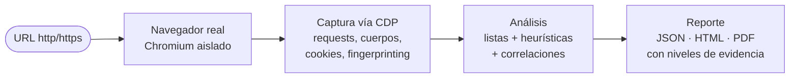

Cuatro formas de capturar:

| Modo | Qué es |
|---|---|
| **Scan simple** | Una visita automatizada a la URL, sin iniciar sesión. |
| **Opciones avanzadas** | Repite la visita cambiando la respuesta al banner de cookies y el perfil del navegador; agrega (mediana, rango, «k de N»). |
| **Captura interactiva** | Usted navega dentro del Chromium del analizador (vía noVNC) y al detener se analiza toda la sesión. |
| **Importar HAR** | Analiza un `.har` exportado desde su propio navegador (DevTools → Red → Exportar HAR). |

## 4. Arquitectura

Cinco contenedores en redes Docker **aisladas**. El worker —que es quien visita sitios no
confiables— **no tiene ruta a internet** salvo a través del proxy.

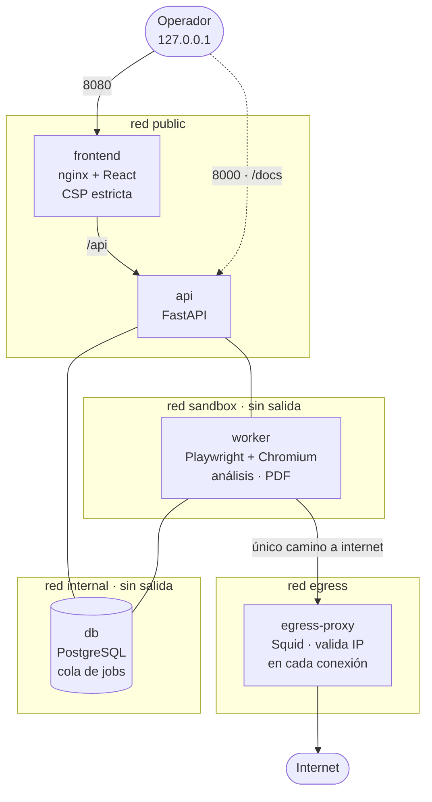

| Contenedor | Rol | Red(es) | Puerto |
|---|---|---|---|
| **frontend** | nginx sin privilegios sirve la SPA de React; CSP sin `unsafe-inline`; proxy `/api` | `public` | `127.0.0.1:8080` |
| **api** | FastAPI: valida URLs, encola jobs, sirve reportes y OpenAPI | `public`, `internal` | `127.0.0.1:8000` |
| **db** | PostgreSQL 16: cola `jobs` (`FOR UPDATE SKIP LOCKED`), capturas y análisis | `internal` | — |
| **worker** | Playwright + Chromium: captura, analiza, renderiza PDF, aplica retención | `internal`, `sandbox` | — |
| **egress-proxy** | Squid: la **única** salida a internet; valida la IP resuelta en cada conexión | `sandbox`, `egress` | — |

**¿Por qué no un solo contenedor?** Por **segmentación**: el componente que ejecuta código y
contenido de sitios no confiables (el worker) queda en redes `internal: true`, sin ruta a internet
excepto por el proxy. Si algo saliera mal en la captura, no puede alcanzar la base de datos desde
fuera ni la red local del equipo. Cada servicio corre sin root, con `cap_drop: ALL`,
`no-new-privileges`, raíz de solo lectura y límites de CPU, memoria y PIDs
(`scripts/hardening-check.sh` lo verifica).

## 5. El proxy Squid

El `egress-proxy` **no participa en el análisis**: es un control de seguridad. Existe para cerrar el
**SSRF** (que, al pedirle «analiza esta URL», el sistema termine conectándose a algo interno).

- El worker solo puede salir a internet por él; no tiene otra ruta.
- **Valida la IP resuelta en cada conexión** (y en cada redirección), que es la capa que garantiza.
  Rechaza: loopback, rangos privados (`10/8`, `172.16/12`, `192.168/16`), enlace local
  (`169.254/16`, incluido el `169.254.169.254` de metadatos de nube), CGNAT, multicast y reservados;
  IPv6 deshabilitado; nombres de servicios Docker, `localhost`, `*.local`, `*.internal`. `CONNECT`
  solo a 80/443.
- La api hace además una primera validación de la URL (solo `http`/`https`, sin credenciales ni
  puertos raros). Defensa en dos capas; la que manda es el proxy.

## 6. Cómo detecta

- **Captura vía CDP antes de TLS.** Mediante el Chrome DevTools Protocol se registran requests,
  respuestas, `post_data`, WebSockets y la cadena de redirecciones **antes** del cifrado, así que se
  ve el contenido real enviado, no paquetes cifrados.
- **Instrumentación de fingerprinting.** Un *init script* envuelve APIs que distinguen un
  dispositivo (canvas, WebGL, audio, `measureText`, `navigator.*`, pantalla, WebRTC…) y atribuye
  cada llamada al script por su *stack*. Los datos del binding son no confiables: se validan tipo y
  tamaño.
- **Escucha de interacción.** Registra qué scripts escuchan clics, desplazamiento o teclado (solo el
  tipo de evento y el script, nunca el evento), y en la captura interactiva correlaciona la
  interacción real con los envíos.

## 7. Cómo clasifica

Para cada comunicación y para el sitio en conjunto:

- **Origen:** `propio` (mismo dominio), `misma organización` (otro dominio del mismo dueño, según el
  mapa de entidades) o `tercero`. Solo los de **otra organización** cuentan como terceros.
- **Listas:** EasyList y EasyPrivacy (adblock-rust) + mapa de entidades (DDG Tracker Radar o, en
  perfil comercial, AdGuard companiesdb).
- **Mecanismo:** pixel, beacon, fetch/xhr, script, iframe, documento, imagen, estático, cookie,
  storage, websocket.
- **Parámetros y decodificación:** categoría por nombre (inferencia), forma del valor (uuid, hex,
  base64, jwt, timestamp…) y decodificación recursiva (URL, Base64, hex, JSON, JWT, query, gzip),
  guardando siempre el valor original.
- **Correlaciones (con evidencia):** sincronización de identificadores entre organizaciones, ID
  persistente (cookie/storage reenviado), fuga de URL/Referer a un tercero, exfiltración de un
  atributo leído que reaparece en una request, y envío de la interacción del usuario.
- **Contexto:** tipo de servicio de cada organización o host (analítica, publicidad, antifraude, CDN,
  mapas, fuentes, clima…), **varias cuentas de analítica** del mismo proveedor en un sitio,
  **telemetría propia** (al propio sitio, no es tercero), **consentimiento** (TCF y Google Consent
  Mode, sin juicio legal), **bloqueo antibot** (captcha/desafíos) e **ID de cuenta del sitio** (GA,
  GTM, Meta…: identifican al sitio ante su proveedor, no al visitante).
- **Scoring explicable:** un `tracking_score` por request (suma de señales con su peso) y un
  **índice de exposición** por sitio (0–99, asintótico), ambos con su desglose en el reporte.

## 8. Niveles de evidencia

Todo hallazgo es `{afirmación, nivel, referencias}`:

| Nivel | Significado |
|---|---|
| **EVIDENCIA** | Observado directamente en la captura (p. ej. una cookie de tercero con vencimiento largo). |
| **INFERENCIA** | Deducido de una señal indirecta (p. ej. el nombre de un parámetro sugiere un identificador). |
| **POSIBLE** | Compatible con lo observado, pero no confirmado. |
| **DESCONOCIDO** | No hay datos suficientes. |

Un recurso de un tercero no es, por sí solo, un rastreador; un nombre de parámetro no prueba su
contenido. Las frases nombran el mecanismo y, si no son EVIDENCIA, llevan siempre un matiz
(«podría», «es compatible con»).

## 9. Recorrido por la interfaz

Menú: **Panel · Analizar un sitio · Historial · Glosario**. Arriba a la derecha: tema **Clásico** o
**Unidad Púrpura** y **modo presentación** (las capturas usan Unidad Púrpura).

**Panel** — inicio: totales, organizaciones «presentes en k de N sitios», atributos más leídos y
enviados, ranking por índice de exposición y la tarjeta «Mi exposición».
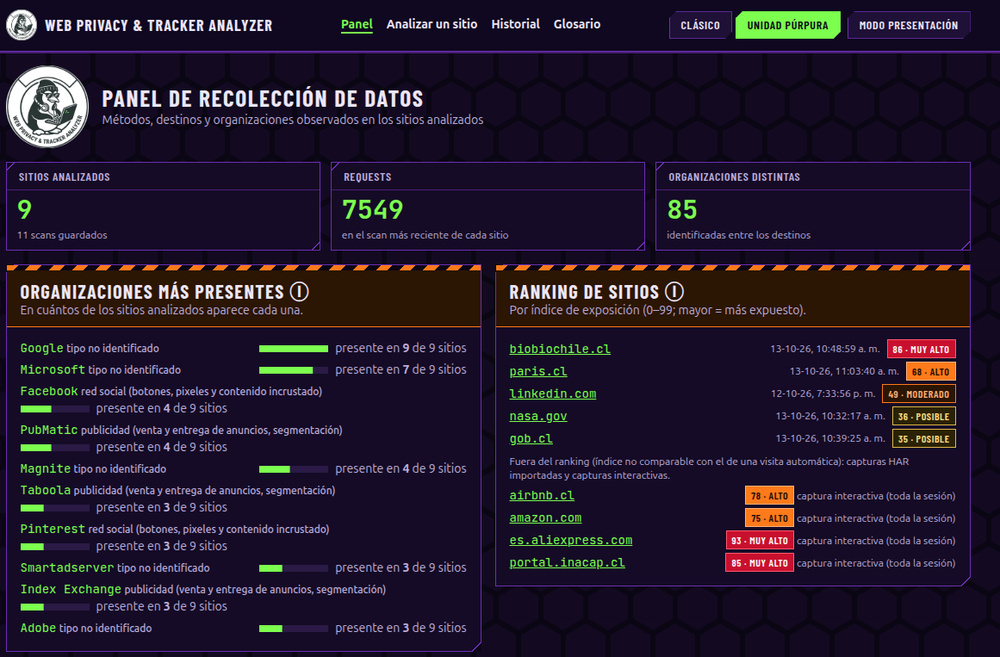

**Analizar un sitio** — una URL, con «Opciones avanzadas», «Captura interactiva» e «Importar HAR».
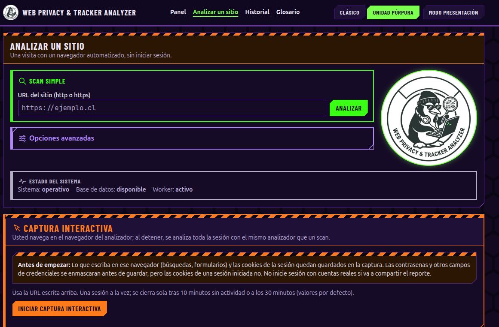

**Historial** — scans y grupos guardados, con filtros por fecha, sitio y estado.
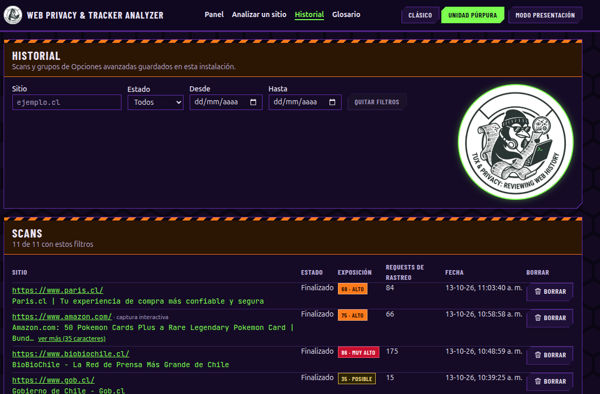

**Resumen del scan** — índice de exposición (0–99) con su desglose, terceros, organizaciones,
exfiltraciones y fugas de URL.
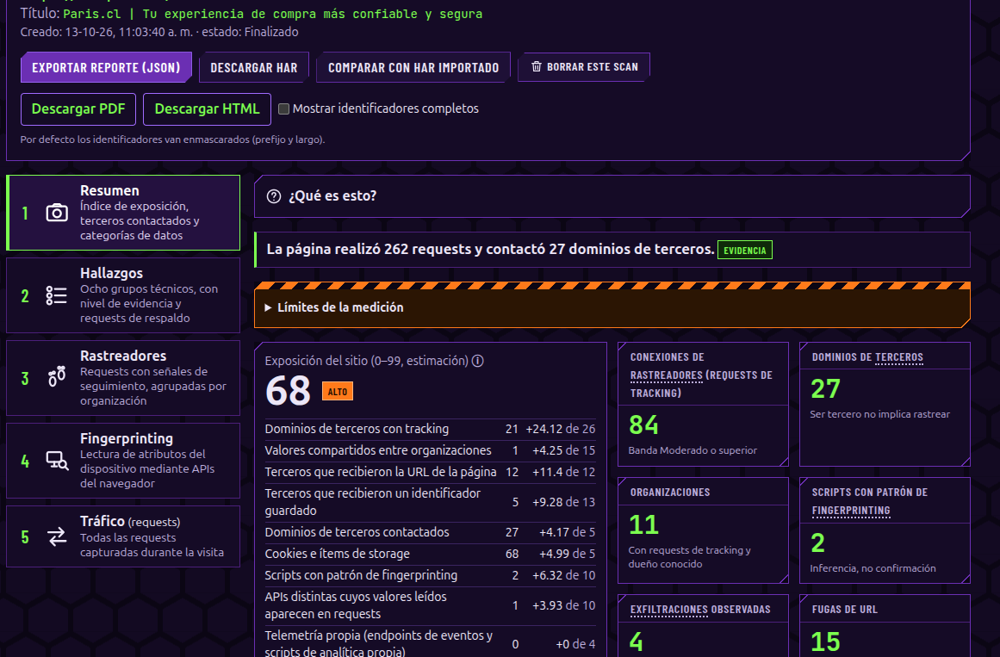
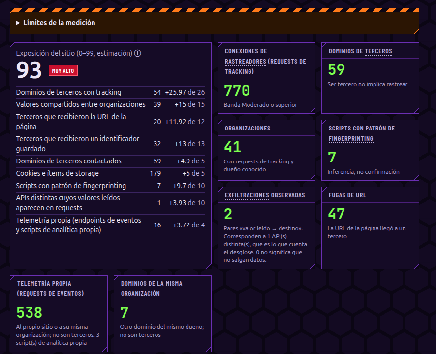

**Hallazgos** — ocho grupos técnicos con su nivel y conteo; debajo, la lista técnica completa.
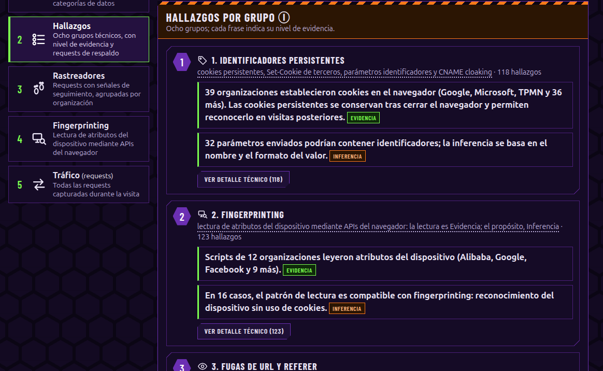

**Rastreadores** — requests con señales de seguimiento, agrupadas por organización.
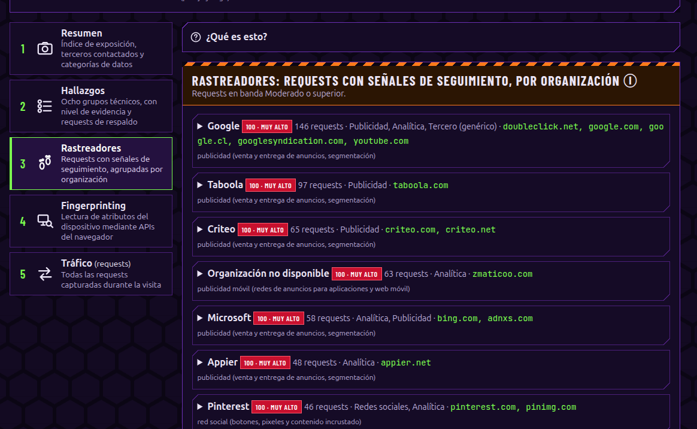

**Servicios de terceros sin señales de rastreo** (v1.4.5) — en Rastreadores, en el Resumen y en los
reportes: las otras organizaciones que la página contacta para funcionar, con su **tipo de servicio**
(mapas, fuentes tipográficas, CDN de librerías, antibot, clima, widgets para compartir en redes, video…)
y sus requests. Se muestra **siempre**, también cuando no hay rastreadores: un sitio sin rastreadores no
es un sitio sin terceros.

| Organización | Tipo de servicio | Dominios | Requests |
|---|---|---|---|
| OpenStreetMap Foundation | mapas | `a.tile.openstreetmap.org`, `b.tile…` | 12 |
| Google | antifraude publicitario/antibot | `www.google.com`, `www.gstatic.com` | 10 |
| Cloudflare | CDN de librerías | `cdnjs.cloudflare.com` | 9 |
| OpenWeather | clima | `api.openweathermap.org` | 2 |
| Organización no disponible | tipo no identificado | `apis.ejemplo.cl` | 39 |

- La request observada es **Evidencia**; el tipo de servicio es **contexto** (Inferencia): describe a qué
  se dedica normalmente ese servicio, no qué hizo en esa visita.
- No mostrar señales de rastreo **no** significa no recibir datos: cada servicio recibe, como mínimo, la
  dirección IP y el navegador del visitante.
- La organización sale del mapa de entidades y de un catálogo propio (`data/organizations.yaml`). Si el
  dato corresponde a una **persona natural** (quien registró el dominio), se muestra «no disponible»:
  nunca se muestran nombres de personas.

**Fingerprinting** — «Atributos de su navegador que leyó este sitio» (atributo · leído por ·
enviado a) y los scripts que llaman a APIs del dispositivo.
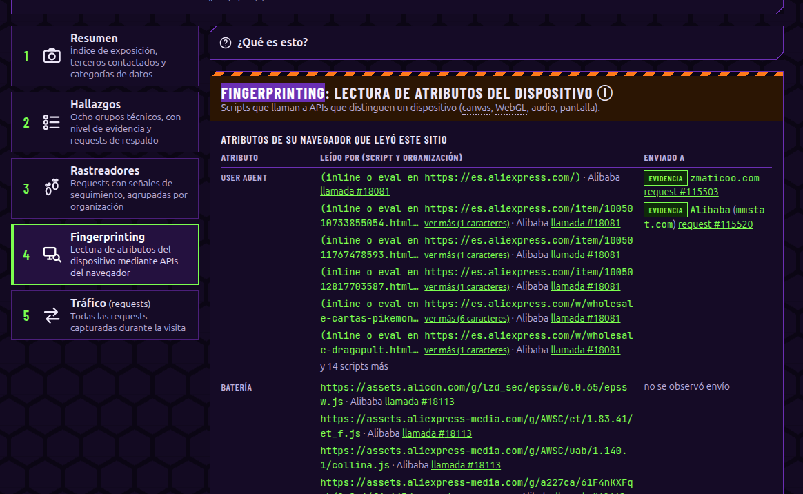

**Tráfico (requests)** — todas las requests capturadas durante la visita, con filtros y su frase
técnica.
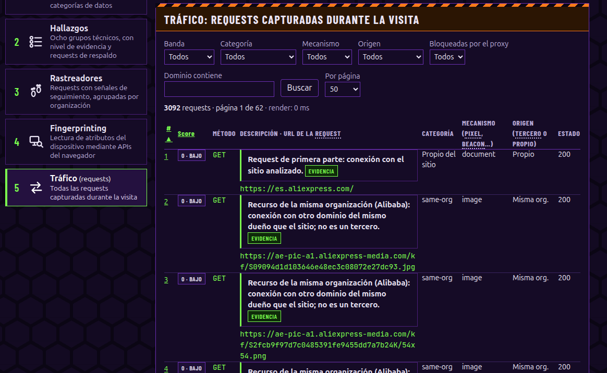

Cada request y cada hallazgo empieza con una **frase técnica** (plantilla determinista, no texto
generado) y un **Ver detalle técnico** con URL, parámetros, decodificaciones, cabeceras, reglas y
pesos. Hay un **indicador de recursos** fijo al pie (CPU/RAM del stack, scans activos), que reserva
su propio hueco y se puede minimizar a un ícono (v1.4.3).

## 10. Ventajas, limitaciones y roadmap

**Ventajas:** autohospedado y offline (los datos viven en `data/`, montados de solo lectura);
explica cada afirmación con su evidencia y su peso; captura el contenido real antes de TLS; reportes
reproducibles con su `sha256`; endurecimiento verificable; en español, con glosario y modo
presentación.

**Limitaciones declaradas:** Playwright no ve todo el tráfico interno del navegador; los Service
Workers (bloqueados por defecto) pueden alterar lo observado; el modo *headless* puede cambiar el
comportamiento del sitio; la geolocalización por IP es aproximada; no hay GPS sin permiso. Ver
[docs/SPEC.md](docs/SPEC.md) §Limitaciones y cada ADR.

**Roadmap (ideas):** más fuentes de listas y entidades; mejores heurísticas de fingerprinting;
comparación en el tiempo (scans programados y diferencias entre fechas del mismo sitio); más idiomas
en la interfaz.

## 11. Comparación con otras herramientas

Cada herramienta resuelve un problema distinto; esta no las reemplaza.

| Herramienta | Qué hace | En qué se diferencia de este proyecto |
|---|---|---|
| **Wireshark** | Captura de paquetes a nivel de red. | Ve metadatos de red pero no el contenido de HTTPS sin claves, ni clasifica rastreadores. Aquí se captura a nivel de aplicación (antes de TLS) y se explica quién recibe qué. |
| **Burp Suite** | Proxy de interceptación para *pentesting* web (MITM de HTTPS, manual). | Orientado a seguridad ofensiva y manual. Aquí el foco es la **privacidad**: clasificación automática, scoring explicable y niveles de evidencia. |
| **DevTools (navegador)** | Inspección de red por página en su propio navegador. | Sin clasificación, scoring, mapa de entidades ni correlaciones; es manual. Aquí todo eso es automático y además se puede **importar el HAR** de DevTools. |
| **Blacklight (The Markup)** | Escáner online de rastreadores conocidos. | Hospedado y acotado a sus comprobaciones. Aquí es autohospedado y offline, con más detalle, captura interactiva, HAR y evidencia por request. |
| **Cover Your Tracks (EFF)** | Mide la *identificabilidad* de **su** navegador frente a una población (bits de entropía). | Aquí «Mi exposición» describe los atributos de forma **cualitativa** (sin afirmar bits ni unicidad) y el foco está en el **análisis del sitio**, no solo del navegador. |

## 12. Requisitos, descarga, instalación y uso

**Requisitos:** Linux con **Docker** y **Compose v2**, más `curl`, `openssl` y `python3` en el host;
unos **6 GB de disco** y **6 GB de RAM** libres. Conexión a internet (para descargar los datos de
terceros y para visitar los sitios).

**Instalación:**

```sh
git clone https://github.com/pulentoski/web-privacy-analyzer-libre-WPAL-.git
cd web-privacy-analyzer-libre-WPAL-
./scripts/start.sh
```

Abra <http://127.0.0.1:8080>. Eso es todo.

La primera vez, `start.sh` genera `.env` a partir de `.env.example`: crea `POSTGRES_PASSWORD`,
`PROXY_SCAN_SECRET` y `EXPOSURE_PRESENTER_TOKEN` con `openssl` y detecta el resolver DNS real del
equipo (`UPSTREAM_DNS`) y la red (`LAN_GATEWAY`, `HOST_LAN_IP`). Si no logra detectar `UPSTREAM_DNS`,
lo avisa y queda en `CAMBIAR` para que lo complete a mano (`resolvectl status`, nunca `127.0.0.53`).
Después **descarga los datos de terceros si faltan** (`scripts/fetch-data.sh`: listas, base de IP y
lista de CMP), levanta el stack con `docker compose up -d --build` y espera a que todo esté `healthy`.

- Interfaz: <http://127.0.0.1:8080>  ·  API: <http://127.0.0.1:8000/health>  ·  OpenAPI: `/docs`
- `curl -s http://127.0.0.1:8000/health` → `{"status":"ok","database":true,"worker":true}`
- Ambas escuchan **solo en loopback**.
- El navegador que visita los sitios se presenta en **español de Chile** (`es-CL`, zona
  `America/Santiago`); se cambia con `WORKER_LOCALE` y `WORKER_TIMEZONE` en `.env`.
- ¿Prefiere revisar la configuración antes de arrancar? Copie `.env.example` a `.env` a mano y edítelo;
  si `.env` ya existe, `start.sh` lo respeta. El resto de variables están documentadas en `.env.example`.

> También puede descargar el `.zip` desde la página de *Releases* y descomprimirlo en vez de clonar.

**Uso:** abra <http://127.0.0.1:8080>, vaya a «Analizar un sitio», escriba una URL y lea el resultado
de arriba hacia abajo (§9).

**Actualizar los datos** (listas, IP, CMP; se publican periódicamente):

```sh
./scripts/fetch-data.sh --force      # o, por fuente:
./scripts/update-lists.sh            # EasyList/EasyPrivacy + entidades DDG
./scripts/update-ipdb.sh             # DB-IP Lite (país y ASN)
./scripts/update-cmp-list.sh         # lista de CMP de IAB
./scripts/update-companiesdb.sh      # solo para LICENSE_PROFILE=comercial
```

**Pruebas** (necesita Docker; usa el perfil `test` con fixtures):

```sh
./scripts/test.sh                    # api, worker (incl. SSRF), frontend y e2e
```

**Apagar:**

```sh
docker compose down                  # conserva los datos (volúmenes)
docker compose down -v               # borra también la base de datos
```

Más en [docs/OPERACION.md](docs/OPERACION.md).

## 13. Seguridad y uso responsable

- **No la exponga a internet.** Escucha solo en `127.0.0.1` y **no tiene autenticación**. El único
  modo pensado para la LAN es la demo de «Mi exposición» (`scripts/demo.sh`, `DEMO_MODE=1`).
- **No use cuentas reales en la captura interactiva:** las cookies de una sesión iniciada quedan
  guardadas en la captura (las contraseñas se enmascaran, las cookies no).
- Analice **sitios propios** o con permiso; una visita no es una evaluación del sitio.
- Secretos solo en `.env` (en `.gitignore`). Revise los reportes antes de compartirlos.
- Verificación: `scripts/hardening-check.sh` (endurecimiento) y `scripts/security-scan.sh`
  (pip-audit, npm audit, Trivy, gitleaks). Modelo de amenazas en
  [docs/THREAT-MODEL.md](docs/THREAT-MODEL.md). Para reportar una vulnerabilidad: [SECURITY.md](SECURITY.md).

## 14. Licencia y créditos

- **Código:** [Apache License 2.0](LICENSE).
- **Logo e ilustraciones de marca** (`branding/` y derivados): propiedad de **pulentoski**, **no**
  bajo Apache-2.0; ver [NOTICE](NOTICE).
- **Datos de terceros** (no incluidos; se descargan): EasyList/EasyPrivacy, DuckDuckGo Tracker Radar
  (CC BY-NC-SA 4.0, **no comercial**), DB-IP Lite (CC BY 4.0, *IP Geolocation by DB-IP —
  https://db-ip.com*), lista de CMP de IAB y, opcional, AdGuard companiesdb (CC BY-SA 4.0). Detalles
  en [NOTICE](NOTICE) y `data/*/LICENSES.md`.
- Autor: **pulentoski**. Cómo contribuir: [CONTRIBUTING.md](CONTRIBUTING.md).

Más documentación: [docs/SPEC.md](docs/SPEC.md) (especificación) ·
[docs/adr/](docs/adr/) (decisiones de diseño) · [docs/OPERACION.md](docs/OPERACION.md) ·
[docs/GUIA-DEMOSTRACION.md](docs/GUIA-DEMOSTRACION.md) · [docs/PUBLICAR.md](docs/PUBLICAR.md).

## 15. Desarrollo

Este proyecto se construyó con **asistencia de IA** (Claude Code), bajo revisión y decisiones de la
persona autora. El archivo [`CLAUDE.md`](CLAUDE.md) de la raíz son las **reglas para el agente**: qué
leer antes de tocar nada ([docs/SPEC.md](docs/SPEC.md)), los principios irrenunciables (ningún
hallazgo sin nivel y evidencia; nunca inventar datos; el worker solo sale por el proxy; secretos solo
en `.env`) y que las decisiones de diseño no triviales se registran en [docs/adr/](docs/adr/).

Todo cambio se **valida con pruebas** antes de darse por terminado: las unitarias de api, worker y
frontend corren en cada `push` y `pull_request` ([](https://github.com/pulentoski/web-privacy-analyzer-libre-WPAL-/actions/workflows/tests.yml)),
y la suite completa —incluidas SSRF y e2e— se ejecuta en local con `./scripts/test.sh`, que necesita
el stack de test con fixtures.
